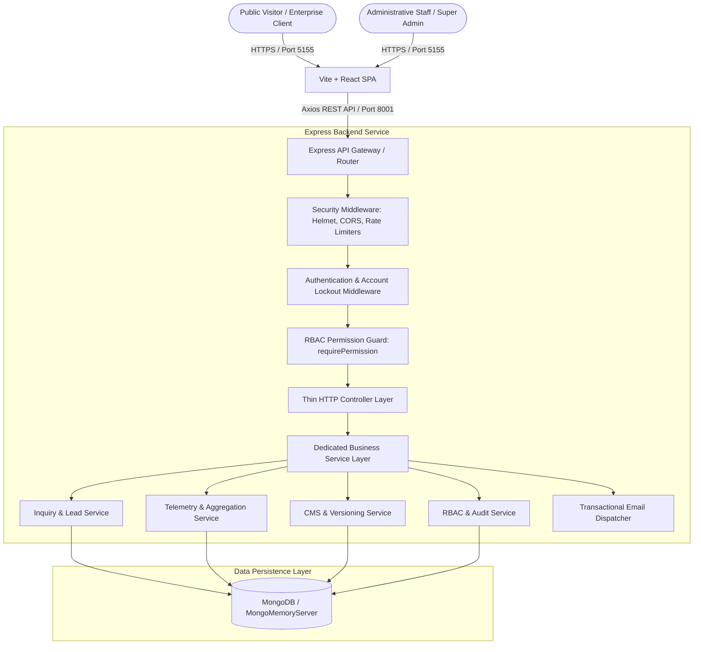
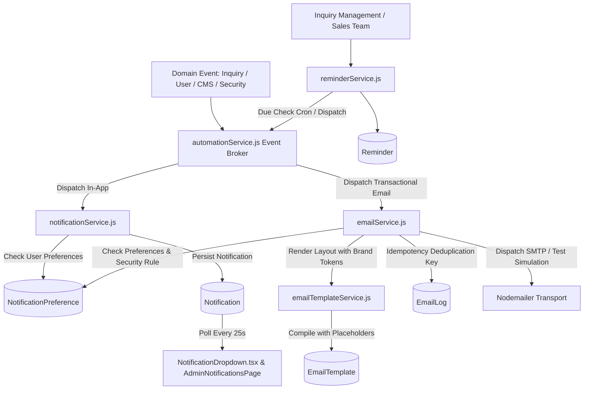

# Peace Haven Corporate Website — Architecture & Systems Specification

## 1. System Overview

Peace Haven is a multi-industry corporate technology enterprise specializing in Web Development, FinTech, Robotics & Automation, Drone Technology, Healthcare Solutions, Technical Staffing, Quantitative Trading Systems, and Digital Growth.

The software platform consists of:
1. **Frontend Application**: Modern Single Page Application (SPA) built with React 18, Vite 5, Tailwind CSS, TypeScript 5, React Router v6, and TanStack React Query v5.
2. **Backend API Service**: High-performance RESTful API microservice built on Node.js and Express v4 (ES Modules), with MongoDB and Mongoose v8 persistence.
3. **Enterprise RBAC & Security Layer**: Role-Based Access Control matrix supporting 7 system roles, 15 permission modules, append-only immutable audit logging, and account lockout protection.
4. **Telemetry & Conversion Engine**: Anonymous visitor tracking, event deduplication, and an 8-stage commercial conversion funnel connected directly to lead management.
5. **Content Management System (CMS)**: Versioned content engine with automated snapshot generation, rollback capabilities, media library, and dynamic navigation.
6. **Notification, Email Automation & Communication Engine**: Centralized event broker (`automationService`), transactional email dispatcher with Peace Haven branded templates (`emailService`, `emailTemplateService`), in-app notification dropdown with real-time polling, reminder scheduling, and user notification preference matrix.



---

## 2. Frontend Architecture (`client/`)

### 2.1 Design Tokens & Cinematic UI
- **Primary Color Palette**: Dark Navy (`#030712`, `#0a0f1d`), Electric Blue (`#2563eb`, `#1d4ed8`), Cyan Accent (`#06b6d4`, `#22d3ee`).
- **Interactive Visuals**: `ParticleHeroCanvas` provides a high-performance 60 FPS HTML5 canvas particle constellation with distance-based tethering and automatic `prefers-reduced-motion` detection.
- **Glassmorphic Components**: Layered semi-transparent backdrops (`backdrop-blur-md bg-slate-900/60 border border-slate-800/80`).

### 2.2 Client Layer Structure
```
client/src/
├── components/
│   ├── common/         # Atomic primitives: Navbar, Footer, MobileMenu, PermissionGuard, AccessDenied
│   ├── layout/         # Shell layouts: PublicLayout, AdminLayout
│   ├── sections/       # Domain sections: HeroSection, ServicesSection, IndustriesSection, etc.
│   └── inquiry/        # 5-step guided inquiry modal and interactive form components
├── pages/
│   ├── public/         # Public pages: HomePage, ServicesPage, IndustriesPage, PortfolioPage, etc.
│   └── admin/          # Admin pages: AdminDashboardPage, AdminUsersPage, AdminRolesPage, etc.
├── services/
│   └── api/            # Domain API clients: client.ts, adminApi.ts, inquiriesApi.ts, etc.
├── hooks/              # Custom React hooks (useAuth, useInquiryForm, useTelemetry)
├── context/            # React Context providers (AuthContext, ThemeContext)
└── types/              # Comprehensive TypeScript type definitions
```

### 2.3 Route & Navigation Hierarchy
- **Public Routes**:
  - `/` — Homepage (Hero, Capabilities, 10 Industries, Case Studies, Philosophy, Contact CTA)
  - `/services` & `/services/:slug` — 8 Core Engineering Disciplines
  - `/industries` & `/industries/:slug` — 10 Industry Verticals
  - `/portfolio` & `/portfolio/:slug` — Prototype laboratory & case studies
  - `/about` — Executive leadership, engineering credentials, values
  - `/contact` — Interactive multi-step inquiry intake system
- **Administrative Routes** (Protected by `AdminLayout` and `PermissionGuard`):
  - `/admin` — Central Admin Dashboard & telemetry overview
  - `/admin/users` — Administrative user provisioning and status toggles
  - `/admin/roles-permissions` — RBAC permission matrix configuration
  - `/admin/audit-logs` — Immutable audit log viewer with CSV export
  - `/admin/profile` — Personal profile, security credentials, active sessions
  - `/admin/inquiries` — Project lead pipeline & qualification triage
  - `/admin/analytics` — Business intelligence & funnel analytics
  - `/admin/cms` — Dynamic page, media, and navigation management
  - `/admin/notifications` — Centralized notifications dashboard & email delivery log
  - `/admin/reminders` — Scheduled lead follow-up & inquiry reminders
  - `/admin/notification-settings` — Admin personal notification preferences & frequency matrix

---

## 3. Backend Architecture (`server/`)

### 3.1 3-Tier Layered Architecture Pattern
The backend adheres to a strict 3-tier architecture:
1. **Controller Layer (`server/src/controllers/`)**: Handles HTTP requests, parameter extraction, Zod validation handling, and status code responses. Controllers contain **no database logic**.
2. **Service Layer (`server/src/services/`)**: Implements core business logic, domain rules, notifications, complex MongoDB aggregations, and data formatting.
3. **Data Access Layer (`server/src/models/`)**: Mongoose schemas defining database structures, constraints, virtuals, and append-only pre-hooks.

### 3.2 Backend Directory Structure
```
server/src/
├── config/             # Environment, database, and rate-limiting configuration
├── controllers/        # Thin HTTP controllers (authController, adminManagementController, etc.)
├── middleware/         # Auth verification, RBAC requirePermission, error handler, rate limiters
├── models/             # Mongoose schemas: AdminUser, Role, AuditLog, Inquiry, Page, etc.
├── routes/v1/          # RESTful route definitions grouped by domain
├── services/           # Business services: rbacService, inquiryService, analyticsService, etc.
└── validators/         # Zod schemas for input validation
```

---

## 4. Role-Based Access Control (RBAC) & Security Architecture

### 4.1 System Roles
The system provides 7 predefined roles with configurable permissions:
1. **Super Administrator (`superadmin`)**: Complete system authority. Root permissions across all 15 modules. Cannot be deleted or deactivated if it is the last remaining active superadmin.
2. **Administrator (`admin`)**: Broad management authority over operations, users, leads, CMS, and analytics.
3. **Content Manager (`content_manager`)**: Full CMS, pages, blog, media, and navigation authority.
4. **Editor (`editor`)**: Content authoring and revision rights with publication workflows.
5. **Marketing Manager (`marketing_manager`)**: Analytics, SEO, campaign tracking, and content review.
6. **Sales Manager (`sales_manager`)**: Lead qualification, inquiry triage, client dossiers, and notes.
7. **Viewer (`viewer`)**: Read-only oversight across authorized modules.

### 4.2 16 Governed Permission Modules
Each module supports granular actions (`read`, `create`, `update`, `delete`, `publish`, `export`):
1. `dashboard` — High-level metric visibility
2. `users` — Administrator user provisioning & status management
3. `roles` — RBAC matrix configuration & custom role creation
4. `cms` — Dynamic page content authoring
5. `services` — Service discipline capability editing
6. `industries` — Industry vertical solution editing
7. `portfolio` — Case study and prototype management
8. `blog` — Technical insights publication
9. `media` — Media asset uploading & storage
10. `navigation` — Header/footer link management
11. `seo` — Metadata, OpenGraph, and sitemap configuration
12. `analytics` — Telemetry & conversion funnel metrics
13. `inquiries` — Project lead pipeline & client dossiers
14. `notifications` — Alerts, email logs, reminder scheduling & template preview
15. `audit_logs` — Immutable audit log review & export
16. `settings` — System-wide security and environment parameters

### 4.3 Brute-Force & Account Lockout Defense
- **Max Failed Attempts**: 5 consecutive incorrect passwords.
- **Lockout Duration**: 15 minutes (`lockUntil` timestamp).
- **Audit Logging**: Every failed attempt and lockout is immutably logged with client IP and user agent.

### 4.4 Append-Only Audit Integrity
Audit logs cannot be edited or deleted through the API. The Mongoose model enforces strict pre-hooks:
```javascript
// Pre-hooks prevent modification or deletion of audit logs
auditLogSchema.pre('updateOne', function () {
  throw new Error('Audit logs are append-only and cannot be updated.');
});
auditLogSchema.pre('findOneAndDelete', function () {
  throw new Error('Audit logs are append-only and cannot be deleted.');
});
```

---

## 5. Resilient Database Persistence
To guarantee uninterrupted operation across local development, testing, and production:
- In production, the system connects directly to `MONGODB_URI`.
- In offline or local zero-dependency development environments, `server/src/config/db.js` automatically spawns an embedded `MongoMemoryServer` instance if external MongoDB is unreachable, ensuring 100% developer and test uptime.

---

## 6. Notifications, Email Automation & Communication Engine (Phase 11)

### 6.1 Architectural Overview
The Phase 11 communication engine unifies in-app administrative notifications, automated transactional emails, and CRM lead follow-up reminders into an event-driven subsystem.



### 6.2 In-App Notification System
- **Real-Time Polling & Dropdown**: `NotificationDropdown.tsx` mounted in the `AdminLayout` header polls every 25 seconds for unread notifications, rendering unread badges and grouped alert cards.
- **Dedicated Dashboard (`/admin/notifications`)**: Supports tabbed views for active In-App Alerts, Email Delivery Logs, and Email Template testing. Admins can filter by category, mark alerts as read, mark all read, or archive alerts.
- **Standard Notification Categories**:
  - `inquiry` — New leads, triage status modifications, notes.
  - `cms` — Content revisions, draft publications, asset updates.
  - `user_management` — Invitations, role modifications, staff onboarding.
  - `reminder` — Due and overdue lead follow-ups.
  - `security` — Failed login spikes, account lockouts, privilege mutations.
  - `system` — Database health, worker status, backup alerts.

### 6.3 Automated Email System & Branded HTML Templates
- **Brand Palette**: Deep Charcoal Navy (`#17232B`), Muted Teal (`#344B50`), Sage Grey (`#A8B5AE`), Warm Off-White (`#E8E5DC`), and Muted Champagne (`#C4A77D`).
- **10 Core Seeded Templates**:
  1. `client_inquiry_confirmation` — Auto-reply to clients with tracking reference.
  2. `new_inquiry_admin_alert` — Urgent briefing to sales and operations team.
  3. `inquiry_status_update` — Client alert upon stage transitions.
  4. `admin_invitation` — Single-use cryptographic onboarding link.
  5. `password_reset` — Time-limited credential reset token.
  6. `email_verification` — Account security confirmation token.
  7. `account_activation` — Welcome dossier upon invitation acceptance.
  8. `cms_approval_request` — Publication review notice for managers.
  9. `content_published` — Public release notification with live preview link.
  10. `security_alert` — Immediate alert on account lockout or unauthorized attempt.
- **Fail-Safe Delivery & Zero-Crash Simulation**: If SMTP credentials are not configured (local development or tests), the system logs formatted dispatches to console without throwing, and stores full records in `EmailLog`.
- **Idempotency & Retries**: Every outgoing dispatch requires an `idempotencyKey` preventing duplicate emails. Failed dispatches can be manually retried via `/api/v1/admin/emails/:id/retry`.

### 6.4 Notification Preferences Matrix (`/admin/notification-settings`)
- Staff can customize notification delivery channels per category (`inApp: boolean`, `email: boolean`).
- **Mandatory Security Rule**: Security alerts cannot be disabled (`{ inApp: true, email: true }` enforced server-side and UI-locked).
- **Delivery Frequency**: Supports immediate dispatch or aggregated daily digests.

### 6.5 Scheduled Inquiry Follow-Up Reminders (`/admin/reminders`)
- Integrated CRM tool allowing sales staff to link tasks directly to inquiries by tracking reference.
- Priority levels (`low`, `medium`, `high`, `urgent`), due dates, assignee assignment, and automatic status transitions (`completed`, `overdue`).

---

## 7. Project Engagement Intake & Client Communication Architecture

### 7.1 Five-Step Guided Project Engagement Intake (`/start-a-project`)
The client onboarding workflow guides prospective enterprise clients through a structured, multi-step engineering intake designed to capture all commercial, architectural, and operational parameters:

1. **Step 1 — Contact & Organization Information**: Client Full Name, Business Email, Company/Organization Name, Direct Phone Number, Job Title, and Geographic Country/Region.
2. **Step 2 — Selected Disciplines & Market Sector**: Multi-selection matrix of 8 core technical divisions (`Web Development`, `FinTech`, `Robotics & Automation`, `Drone Technology`, `Healthcare Solutions`, `US Staffing`, `Trading & Investment`, `Digital Marketing`), target industry domain, and project classification.
3. **Step 3 — Technical Specifications & Objectives**: Comprehensive initiative overview, core business objectives, required capabilities/features, target deliverables, preferred technology stack, and timeline expectations.
4. **Step 4 — Budget, Timeline & Urgency**: Multi-currency allocation (`USD`, `EUR`, `GBP`, `CAD`, `AUD`, `INR`, `SGD`), tiered budget selection or custom budget amount, urgency rating (`Normal`, `High`, `Urgent / Critical`), and preferred communication channel (`Email`, `Phone`, `Video Meeting`).
5. **Step 5 — Final Review & Submission**: Live dossier verification with contextual edit links, mutual confidentiality acknowledgment, and transactional submission yielding an immutable reference code (format: `PH-XXXXXX-XXXX`).

### 7.2 Dedicated Inquiry Record & Six-Section Dossier (`/admin/inquiries/:id`)
Every inquiry detail view is organized into 6 clearly demarcated engineering sections:
- **Section A — Client Profile & Organization Details**: Client identity, corporate entity, verified email link, direct phone, role, and country.
- **Section B — Selected Services**: Market sector badge and interactive tags for all selected engineering services.
- **Section C — Project Requirements & Scope**: Comprehensive initiative overview, detailed business requirements, core objectives, and required features.
- **Section D — Budget, Currency & Timeline Specifications**: Estimated budget, currency denomination, start preference, timeline window, urgency level, and preferred contact method.
- **Section E — Inquiry Management**: Status pipeline transition buttons, 4-tier priority level selector (`low`, `medium`, `high`, `urgent`), responsible staff allocator, private internal notes thread (hidden from clients), and chronological audit trail.
- **Section F — Client Communication & Email Response**: Direct email composer equipped with template loading, custom messaging, simulated attachment management, and chronological communication history.

### 7.3 Direct Client Communication Engine (`inquiryCommunicationService.js`)
Enables authorized administrators (`inquiries:update`) to draft and transmit official client communications directly from the admin console:
- **11 Standard Corporate Email Templates**:
  1. `inquiry_acknowledgment` — Initial formal acknowledgment of requirements.
  2. `thank_you_requirements` — Thank-you briefing after reviewing initial scope.
  3. `request_additional_info` — Request for technical clarifications or architecture specs.
  4. `project_clarification` — Clarification on constraints, integration, or compliance.
  5. `schedule_discussion` — Invitation to a discovery or scoping session.
  6. `meeting_confirmation` — Confirmation of scheduled call with agenda.
  7. `project_proposal` — Transmission of formal technical proposal and scope.
  8. `quotation_estimate` — Commercial quotation, sprint cost breakdown, and terms.
  9. `follow_up` — Polite follow-up on sent proposal or discussion points.
  10. `inquiry_accepted` — Formal notice of engagement acceptance and onboarding.
  11. `inquiry_closed` — Polite notification of closed or rejected inquiry.
- **Automatic Token Replacement**: Replaces tokens like `{{clientName}}`, `{{companyName}}`, `{{projectTitle}}`, `{{referenceNumber}}`, `{{selectedServices}}`, and `{{adminName}}` with actual inquiry data.
- **Audit Logging & Team Alerts**: Every outgoing communication appends to `inquiry.communicationHistory`, updates `lastCommunicatedAt`, transitions status to `CONTACTED` (if previously `NEW`), logs to the system audit trail, and creates an in-app team alert.

